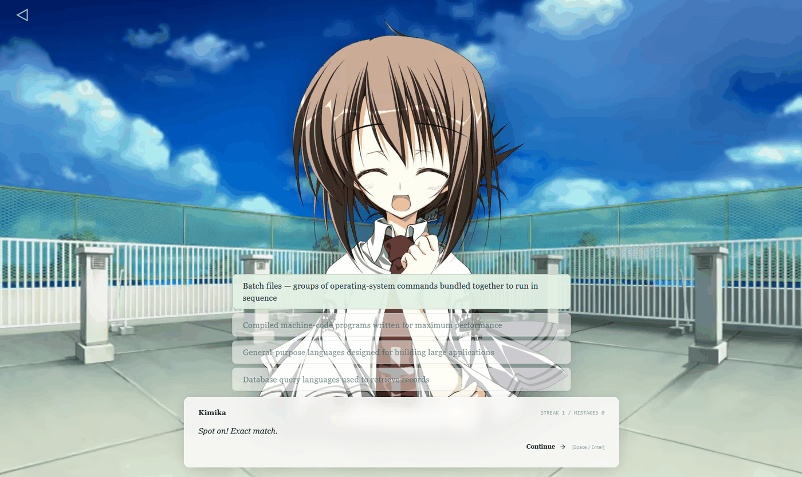
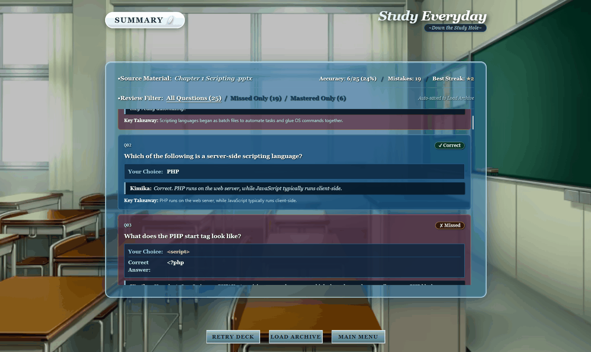
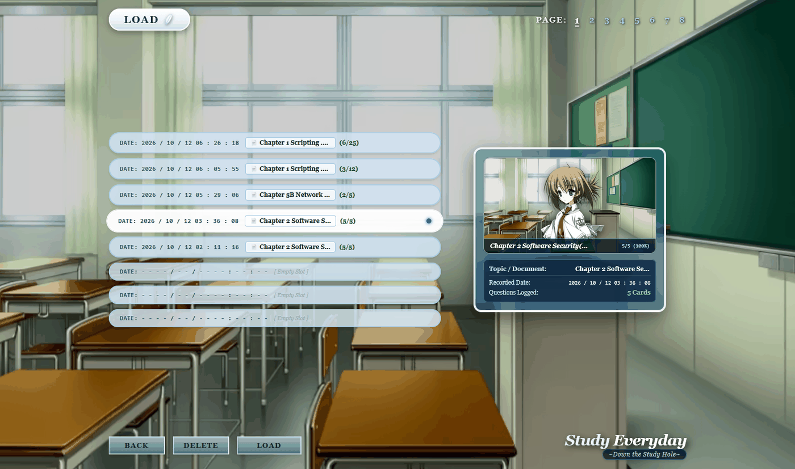

# Study Everyday

A visual novel-style flashcard study app built with React, TypeScript, and Vite. Kimika Tachibana from _Wonderful Everyday_ (_Subarashiki Hibi_) reacts to how you are doing in the session.



## What it does

- Main menu and study screens styled after a visual novel title/options layout
- Upload lecture files (`.pptx`, `.pdf`, `.txt`, `.md`) and extract text in the browser
- Generate multiple-choice flashcards with **Google Gemini** or **DeepSeek**
- Grade answers locally when they match exactly; otherwise send them to the chosen model
- Correct answers show the reason the answer is right, taken from the generated card
- Kimika sprites change with win/lose streaks:
  - no streak: 0–1
  - low streak: 2–5
  - high streak: 6+
- After a session, results are saved in `localStorage` so you can open them from Load

You need an API key for whichever provider you pick — [Google AI Studio](https://aistudio.google.com/app/apikey) or the [DeepSeek Platform](https://platform.deepseek.com/api_keys). Keys are stored in `sessionStorage` for the current tab only, one per provider, and are sent straight from your browser to that provider. There is no backend of our own.

## After a session

Every session is saved, so you can review what you missed or replay a deck. Saved summaries open from the Load screen, laid out like a visual novel save menu.

| Summary                                                                   | Load                                                                    |
| ------------------------------------------------------------------------- | ----------------------------------------------------------------------- |
|  |  |

## Run it locally

Needs Node.js 18+ and npm.

```bash
git clone https://github.com/KLgrimmreaper/study-everyday
cd study-everyday
npm install
npm run dev
```

Then open `http://localhost:5173`.

```bash
npm run test
npm run build
```

## How to play

1. Click **Start** on the main menu.
2. Pick a background, choose a model (Gemini or DeepSeek), and paste that provider's API key.
3. Upload slides/notes and/or type extra focus notes, then pick how many questions you want.
4. Answer the cards. Kimika’s expression follows your streak. Breaking a high lose streak (6+ wrong in a row) uses a special sprite.

## Project layout

Most of the UI lives in `src/screens`, with the smaller pieces (`KimikaSprite`, `ObjectiveAnswerOptions`, `ResultFeedback`, `FeatherGraphic`) sitting next to them in `src`. Game state is in `GameContext.tsx`. Model calls and the provider settings are in `models.ts`, with the model list in `streak.ts`. File parsing is in `parseFiles.ts`, streak and sprite logic in `streak.ts` and `sprites.ts`, and saved sessions in `storage.ts`. The files under `src/test` cover grading, streaks, sprites, both providers, and one full session played end to end.
